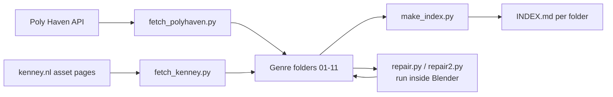

# Blender Kitbash Library

Scripts that build an offline, genre-sorted library of about 570 free CC0 3D assets (Poly Haven and Kenney) for kitbashing in Blender, plus the catalog of what a full build contains.

The assets themselves (about 12.5 GB) are not in this repo. Clone it, run the fetch scripts, and the library fills in around the scripts.

## What it does

- Downloads every Poly Haven CC0 model at 2K textures as a ready `.blend` with a relative `textures/` folder.
- Downloads every Kenney 3D game kit (about 50 kits, 4,600+ meshes in `.obj`, `.fbx`, `.gltf`, `.glb`).
- Routes each asset into one of 11 genre folders using the source's own categories and slug keywords.
- Writes an `INDEX.md` per folder listing asset name, source, formats and size.
- Ships a Blender asset catalog file (`blender_assets.cats.txt`) so the library can be added under Preferences ▸ File Paths ▸ Asset Libraries.
- Repairs the few Poly Haven files whose texture paths still point at the original artists' drives.

## How it works



Both fetchers are idempotent. A finished asset gets a `.complete` marker, so a rerun only downloads what is missing or new. Downloads run in a thread pool.

## Folder map

| Folder | Contents |
|---|---|
| `01_Nature_and_Organic` | Trees, plants, flowers, rocks, terrain scatter |
| `02_Industrial_and_Machinery` | Barrels, crates, tools, pipes, containers |
| `03_Architecture_Structures` | Buildings, city kits, walls, dungeon and cave modules |
| `04_Vehicles_and_Ships` | Cars, spacecraft, boats, planes |
| `05_Weapons` | Firearms, blasters, melee weapons |
| `06_Characters_and_Creatures` | Figures, creatures, character kits |
| `07_Furniture_and_Seating` | Chairs, tables, beds, shelves |
| `08_Electronics_Appliances` | Devices, screens, lighting, appliances |
| `09_Food_and_Kitchen` | Food, dishes, cookware |
| `10_Props_and_Decorative` | Decor, vases, books, instruments |
| `11_Kenney_Game_Kits` | Kenney modular kits that span genres |

Each folder's `INDEX.md` in this repo is the catalog from a full build (521 Poly Haven models + 50 Kenney kits, verified to open in Blender with textures resolving).

## Tech stack

Python 3 standard library only (`urllib`, `concurrent.futures`, `zipfile`) for downloading and indexing. The repair scripts use Blender's `bpy` API.

## Getting started

```bash
git clone https://github.com/ianroyes-sys/blender-kitbash-library
cd blender-kitbash-library
python3 scripts/fetch_polyhaven.py   # ~12 GB at 2K
python3 scripts/fetch_kenney.py
python3 scripts/make_index.py
# optional: fix the known broken texture paths (needs Blender on PATH)
blender --background --python scripts/repair.py
blender --background --python scripts/repair2.py
```

By default assets land next to the scripts (the repo root). Set `KITBASH_LIBRARY=/path/to/library` to put them somewhere else, such as an external drive.

For 4K or 8K textures, change `RES = "2k"` at the top of `scripts/fetch_polyhaven.py` and delete the `.complete` markers of the assets you want upgraded.

Then in Blender: add the folder under **Edit ▸ Preferences ▸ File Paths ▸ Asset Libraries**. Poly Haven `.blend` files are plain scenes, so use **File ▸ Append** or **File ▸ Link** for those (Link keeps kitbash scenes small). Import Kenney kits with **File ▸ Import**; glTF keeps materials most reliably.

`docs/manual-sources.md` lists free sources that need a login and can't be scripted (KitBash3D Cargo, Megascans on Fab, BlenderKit and others), with their license caveats.

## Project structure

```
scripts/
  fetch_polyhaven.py   Poly Haven API -> genre folders, 2K textures
  fetch_kenney.py      scrape Kenney 3D kit zips -> genre folders
  make_index.py        write INDEX.md per folder
  repair.py            (Blender) repoint broken texture paths in 3 upstream files
  repair2.py           (Blender) follow-up pass for AO/metallic maps
01_.. - 11_../INDEX.md catalog of a full build
blender_assets.cats.txt Blender asset catalog definitions
docs/manual-sources.md login-gated free sources and their licenses
```

## Licensing

The scripts are yours to use. Every auto-downloaded asset is CC0 (Poly Haven, Kenney): free for commercial work with no attribution required, though both projects are donation-funded and credit is appreciated. Anything added from the manual sources carries its own license; KitBash3D assets, for example, can't be redistributed in game builds or asset packs.

## Status

Working personal tool. A full run built 571 assets (12.45 GB) in July 2026 and every `.blend` was verified in Blender 5.2.

Built by [Ian Royes](https://github.com/ianroyes-sys)
